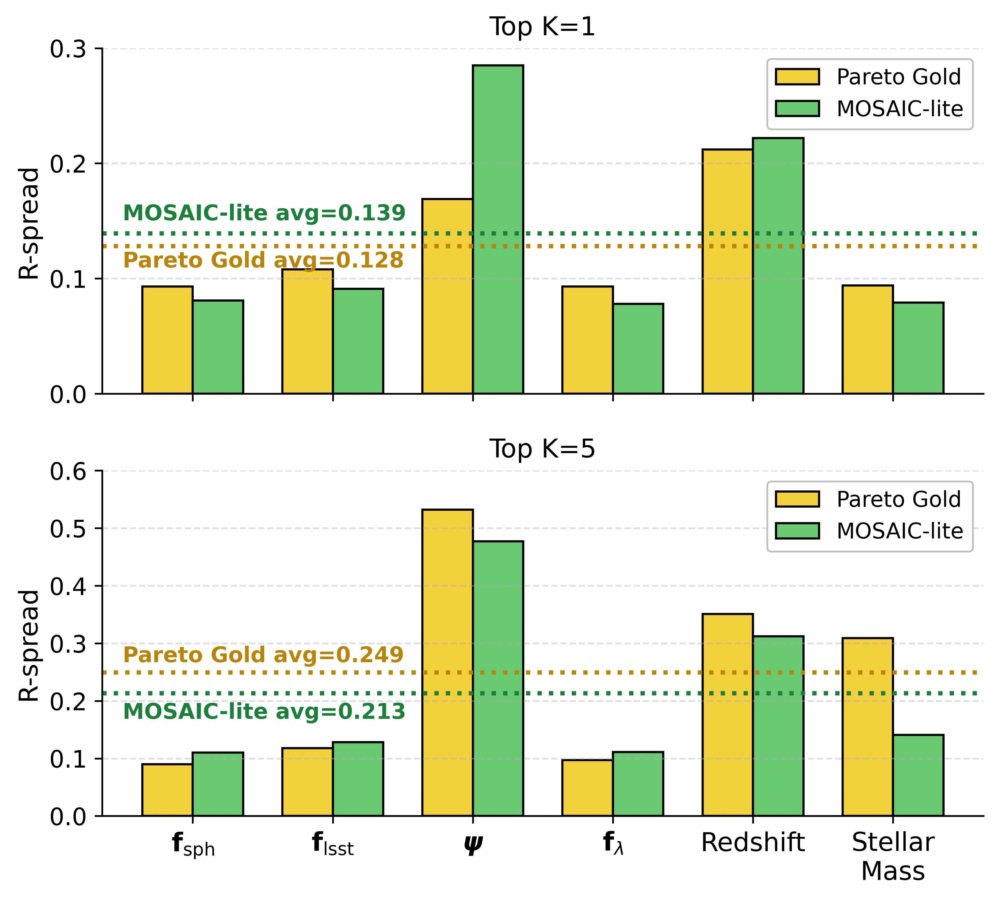

The field of artificial intelligence, particularly foundation models, is rapidly transforming scientific research by offering unprecedented capabilities for data interpretation, hypothesis generation, and discovery. Scientific disciplines, especially astronomy and cosmology, generate vast, complex, and heterogeneous datasets spanning numerical simulations, observational measurements, textual literature, and specialized sensory data like spectroscopy.

Extracting meaningful insights from this data deluge presents significant challenges, necessitating specialized models capable of understanding domain-specific language, complex data structures, and reasoning effectively within scientific paradigms. Generic foundation models often fall short, highlighting the critical need for domain-specific adaptation and multi-modal integration to truly augment human researchers' capabilities and foster new discoveries.

My work significantly advances this field by developing and evaluating domain-specialized foundation models tailored for scientific discovery, with a particular emphasis on astronomy and cosmology. I have pioneered multi-modal foundation models capable of integrating and reasoning across diverse data types, exemplified by my "Multi-modal Foundation Model for Cosmological Simulation Data." My research focuses on enhancing the reasoning capabilities of large language models (LLMs) for scientific applications, achieving "benchmark-topping performance" and "GPT-4o level performance" in astronomy Q&A with domain-specialized 8B and 70B-parameter models, as detailed in the AstroMLab series. This also includes enabling LLMs to interpret highly specialized data, such as "Teaching LLMs to Speak Spectroscopy," allowing them to derive insights from complex spectral signatures.

Beyond traditional Q&A, my contributions extend to novel applications like "Predicting New Concept-Object Associations in Astronomy by Mining the Literature," demonstrating AI's potential to uncover previously unknown scientific relationships. To facilitate efficient data access and analysis in complex scientific environments, I have developed techniques for "Searching the Pareto Front: Multi-Objective Retrieval for Heterogeneous Scientific Modalities." Furthermore, my work includes the development of practical AI research assistants, such as "InferA: A Smart Assistant for Cosmological Ensemble Data," and the establishment of robust methodologies (EAIRA) for "Evaluating AI Models as Scientific Research Assistants." This comprehensive body of work underscores the transformative potential of specialized foundation models in accelerating the pace of scientific discovery and providing powerful, reliable tools for researchers.

  

    
    
From: Searching the Pareto Front: Multi-Objective Retrieval for Heterogeneous Scientific Modalities

  

  

    
    
From: Multi-modal Foundation Model for Cosmological Simulation Data

  

<!-- Figure Modal -->

  &times;
  

