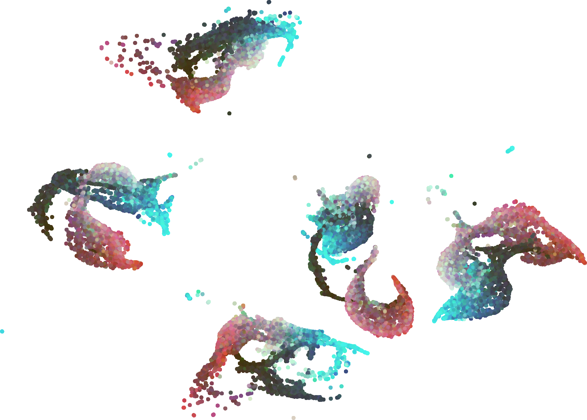

The application of foundation models is rapidly transforming scientific research, offering unprecedented capabilities for processing, interpreting, and generating insights from complex data. In fields such as astronomy and cosmology, scientists grapple with immense, high-dimensional datasets originating from simulations, telescopes, and literature. These datasets are often multi-modal, combining images, numerical tables, and specialized text, presenting significant challenges for traditional analysis methods. The need for AI systems that can not only understand these diverse data types but also perform sophisticated reasoning and act as intelligent research assistants is paramount for accelerating discovery and tackling fundamental scientific questions.

Developing effective AI tools for science necessitates a departure from generic models towards highly specialized architectures and training methodologies. This includes creating models proficient in scientific language, capable of handling specific data formats, and endowed with domain-specific knowledge and reasoning abilities. Furthermore, a critical aspect of integrating AI into the scientific workflow is establishing robust and transparent evaluation methodologies. These frameworks are essential for reliably assessing an AI model’s performance, trustworthiness, and utility as a genuine partner in scientific inquiry, ensuring that these powerful tools genuinely advance our understanding rather than merely automating tasks.

My research focuses on advancing and applying cutting-edge foundation models to address these challenges, particularly within astronomy and cosmology. I have developed a suite of domain-specialized large language models, exemplified by the AstroMLab series (AstroMLab 1, 3, 4), which consistently achieve benchmark-topping performance in complex astronomy Q&A and reasoning tasks. Notably, AstroMLab 3 demonstrated GPT-4o level capabilities with a smaller 8B-parameter model, highlighting the efficiency gains of domain specialization, while AstroMLab 4 scaled this to a 70B-parameter model for advanced reasoning. A core technical contribution includes "Teaching LLMs to Speak Spectroscopy," involving specialized pre-training and fine-tuning to enable language models to interpret and generate insights from intricate spectroscopic data, a cornerstone of astrophysical analysis. I also pioneered multi-modal foundation models for cosmological simulation data, integrating information across visual, numerical, and textual modalities to provide a holistic understanding of complex cosmic phenomena.

Furthermore, my work extends to developing practical scientific assistants and robust evaluation frameworks. I created InferA, a smart assistant designed to streamline the analysis and interpretation of cosmological ensemble datasets, thereby reducing the burden on researchers. Crucially, I established EAIRA, a comprehensive methodology for evaluating AI models as scientific research assistants, providing a structured approach to assess their efficacy, reliability, and scientific rigor. This systematic evaluation ensures that the AI tools I develop are not only powerful but also trustworthy and genuinely contribute to scientific progress, ultimately democratizing access to complex scientific knowledge and accelerating the pace of discovery.

  

    
    
From: Multi-modal Foundation Model for Cosmological Simulation Data

  

<!-- Figure Modal -->

  &times;
  

