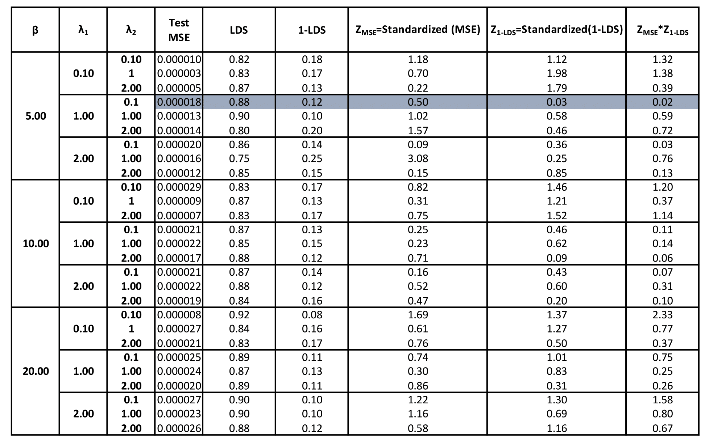
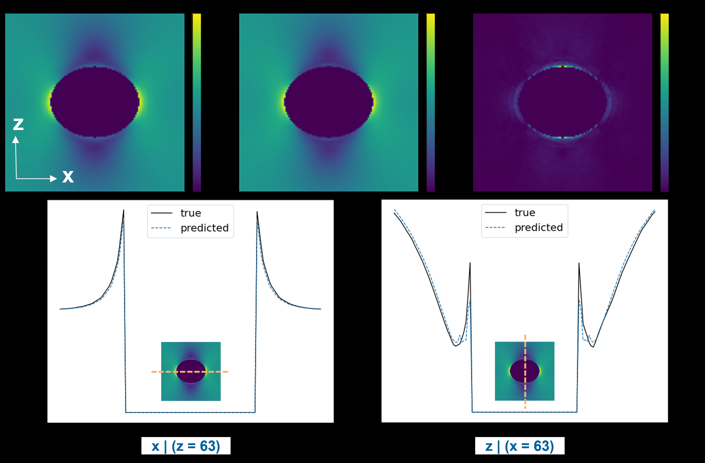

The application of machine learning (ML) and artificial intelligence (AI) is transforming scientific discovery across numerous disciplines, offering powerful new tools to analyze complex data, accelerate simulations, and uncover hidden patterns. This research area addresses critical challenges such as the inherent sparsity of scientific datasets, the high dimensionality of observations, the need for robust uncertainty quantification, and the demand for interpretable models that facilitate scientific insight rather than merely providing predictions. Techniques spanning deep learning, generative modeling, probabilistic frameworks, and automated machine learning are being developed and tailored to address these unique scientific requirements.

In domains like astrophysics and engineering, ML is crucial for tasks ranging from high-resolution image processing and spectral analysis to the reconstruction of complex physical fields and the identification of rare phenomena. For instance, astronomical surveys generate vast quantities of image and spectral data, necessitating automated methods for anomaly detection, galaxy morphology classification, and precise redshift estimation. Similarly, engineering applications often contend with sparse sensor data, requiring advanced modeling to predict stress fields or optimize system performance effectively. The overarching goal is to enhance the accuracy, efficiency, and interpretability of scientific data analysis, pushing the boundaries of what is discoverable with existing and future datasets, such as those from the Rubin LSST.

My research focuses on developing and applying innovative machine learning methodologies to tackle these complex scientific challenges, primarily within astrophysics and engineering. I have developed generative adversarial networks (GANs) and other generative models for anomaly detection in astronomical images, as demonstrated by their application to Hyper Suprime-Cam galaxy images, thereby enabling the discovery of unusual cosmic phenomena. A significant contribution involves enhancing the interpretability of these generative models through statistically disentangled latent spaces, guided by generative factors inherent in scientific datasets, providing a clearer understanding of the underlying physical processes.

Furthermore, my work encompasses the development of robust probabilistic modeling and automated machine learning frameworks, exemplified by their application to high-dimensional stress fields in engineering and the creation of SYTH-Z for machine learning synthetic spectra to achieve probabilistic redshift estimation in astronomy. I have also advanced global field reconstruction from sparse sensor data using Voronoi tessellation-assisted deep learning and explored multi-task modeling to leverage sparse data effectively in engineering applications. Contributions extend to neural network-based point spread function deconvolution for improved astronomical imaging and the use of unsupervised machine learning to explore galaxy morphology beyond traditional classification schemes, unveiling new insights into cosmic evolution. My research also includes a strategic overview of opportunities for AI/ML within major collaborations like the Rubin LSST Dark Energy Science Collaboration, highlighting the broad impact of these advanced techniques.

  

    
    
From: Enhancing Interpretability in Generative Modeling: Statistically Disentangled Latent Spaces Guided by Generative Factors in Scientific Datasets

  

  

    
    
From: Application of probabilistic modeling and automated machine learning framework for high-dimensional stress field

  

<!-- Figure Modal -->

  &times;
  

