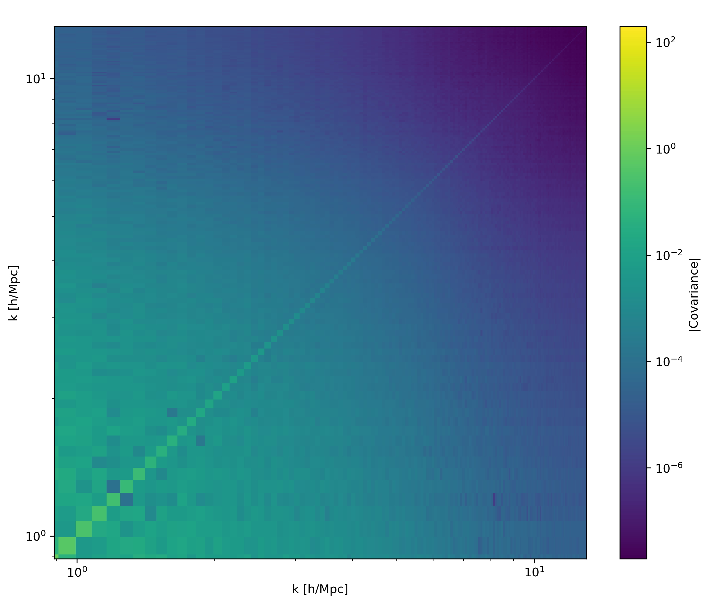

The application of machine learning (ML) and artificial intelligence (AI) has fundamentally transformed scientific research across numerous domains, offering powerful tools to extract profound insights from increasingly complex and vast datasets. In fields like astronomy and cosmology, these techniques are indispensable for processing petabytes of observational data, enabling discoveries that would be intractable with traditional analytical methods. ML facilitates a wide range of tasks, from accelerating intricate simulations and characterizing celestial objects to detecting rare phenomena and mapping the universe's large-scale structure and evolution.

Specifically, advanced ML approaches address critical scientific challenges such as identifying subtle patterns in noisy data, making robust predictions from incomplete or sparse observations, and enhancing the interpretability of complex physical models. Researchers leverage diverse ML paradigms, including deep learning, generative modeling, and probabilistic methods, to push the boundaries of scientific understanding, from the precise classification of stars and galaxies to the accurate estimation of cosmological parameters and the unraveling of fundamental mysteries like dark energy and cosmic structure formation.

My research significantly contributes to this exciting frontier, focusing on developing and applying sophisticated machine learning methodologies to tackle pressing challenges in astrophysics and beyond. I have developed novel techniques to enhance the analysis of large-scale astronomical surveys, such as those from the Rubin LSST Dark Energy Science Collaboration, by directly addressing issues of data sparsity, model interpretability, and observational systematics. For instance, I have advanced multi-task modeling frameworks for engineering applications with sparse data and introduced methods for identifying new concept-object associations in astronomy by mining the scientific literature, thereby accelerating scientific discovery.

A core aspect of my technical contribution involves pioneering generative models, including Generative Adversarial Networks (GANs), for robust anomaly detection in Hyper Suprime-Cam galaxy images and for physically benchmarking AI-evolved cosmological structure formation. To ensure scientific rigor and trust, I have also focused on enhancing model interpretability by developing statistically disentangled latent spaces guided by generative factors in scientific datasets. My work further extends to improving the accuracy of cosmological measurements through optimized galaxy selection for weak lensing cluster mass estimation, and developing neural network-based point spread function deconvolution for clearer astronomical images. I have engineered differentiable prediction models like SHAMNet for large-scale structure, created modular deep learning pipelines for galaxy-scale strong gravitational lens detection and modeling, and employed probabilistic modeling for tasks ranging from highly accurate redshift estimation (SYTH-Z) to the identification of Carbon-Enhanced Metal-Poor star candidates from Gaia DR3 spectra and the reconstruction of global fields from sparse sensors, demonstrating the versatility of these techniques in extracting robust scientific insights and enabling novel discoveries.

  

    
    
From: Benchmarking AI-evolved cosmological structure formation

  

<!-- Figure Modal -->

  &times;
  

