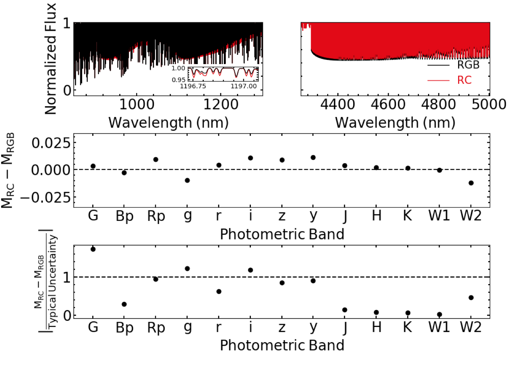
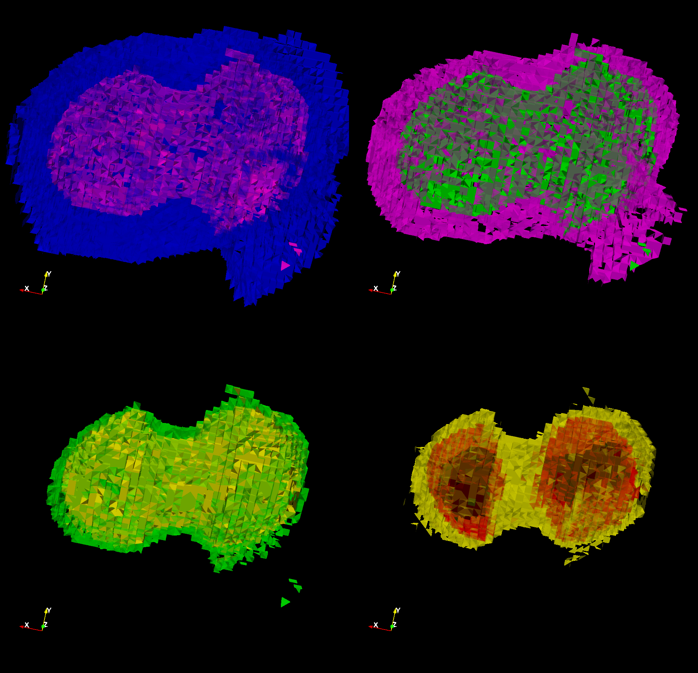
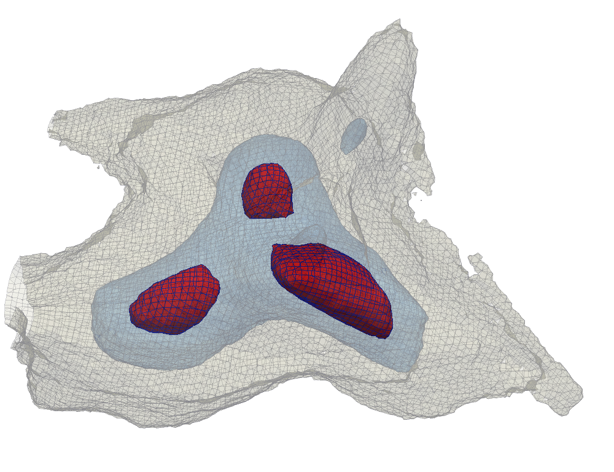

Research in dark matter and cosmology aims to comprehensively understand the universe's fundamental constituents, its evolutionary history, and the formation of the large-scale structures that define its cosmic web. This intricate network of dark matter haloes, filaments, and voids provides the gravitational scaffolding for galaxy formation. Cosmological simulations, particularly N-body and hydrodynamical models, are indispensable tools for predicting the evolution of these structures, offering theoretical frameworks to be rigorously tested against observational data.

Observational cosmology employs diverse techniques to probe the cosmic web and constrain cosmological models. Gravitational lensing, encompassing both weak and strong regimes, directly maps mass distribution, while extensive surveys of galaxy clusters and the cosmic microwave background illuminate large-scale structure and fundamental cosmological parameters. These efforts are crucial for testing General Relativity, exploring alternative theories like $f(R)$ gravity, and characterizing dark matter halo properties. The integration of advanced data science and artificial intelligence, including deep learning, is increasingly vital for analyzing complex datasets and accelerating discovery in this data-rich era.

My research significantly advances these areas through the development and application of cutting-edge computational and analytical techniques. I have extensively utilized N-body simulations to characterize the intricate multi-stream nature, topology, and geometry of the dark matter cosmic web, including its detailed caustic design (papers 3, 4, 5, 6). Leveraging advanced machine learning, including generative models, my work uncovers physical drivers of dark matter halo structures and benchmarks AI-evolved cosmological structure formation (papers 7, 10, 13). I also contributed to the CRK-HACC hydrodynamical simulation code, instrumental for modeling galaxy formation within these evolving cosmic structures (paper 8).

In observational cosmology, my work focuses on robustly constraining cosmological models and enhancing the precision of various probes. I performed $k$-cut cosmic shear analyses using Hyper Suprime-Cam data to constrain alternative gravity theories like $f(R)$ gravity, providing stringent tests of cosmic acceleration (paper 1). I optimized galaxy selection for reduced model error in weak lensing cluster mass estimations (paper 11) and developed modular deep learning pipelines for efficient galaxy-scale strong gravitational lens detection and modeling (paper 15). I also applied deep neural networks for peculiar velocity estimation from the kinetic Sunyaev-Zel'dovich effect (paper 14), enabling more precise cosmological measurements from large surveys (papers 9, 16). Collectively, my research bridges theoretical modeling, advanced simulations, and state-of-the-art data analysis to shed new light on the dark universe.

  

    
    
From: From the Inner to Outer Milky Way: A Photometric Sample of 2.6 Million Red Clump Stars

  

  

    
    
From: The Caustic Design of the Dark Matter Web

  

  

    
    
From: Dark matter haloes: a multistream view

  

<!-- Figure Modal -->

  &times;
  

