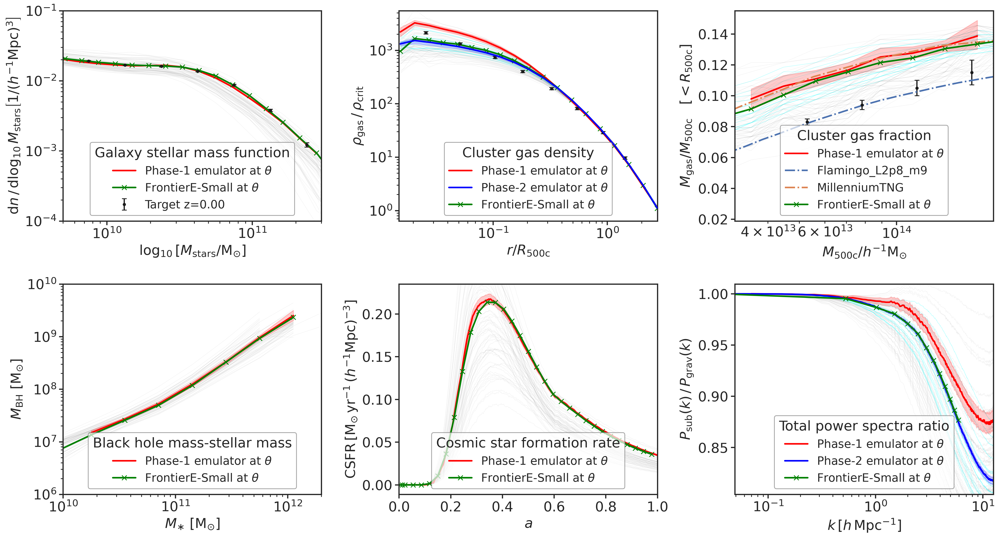
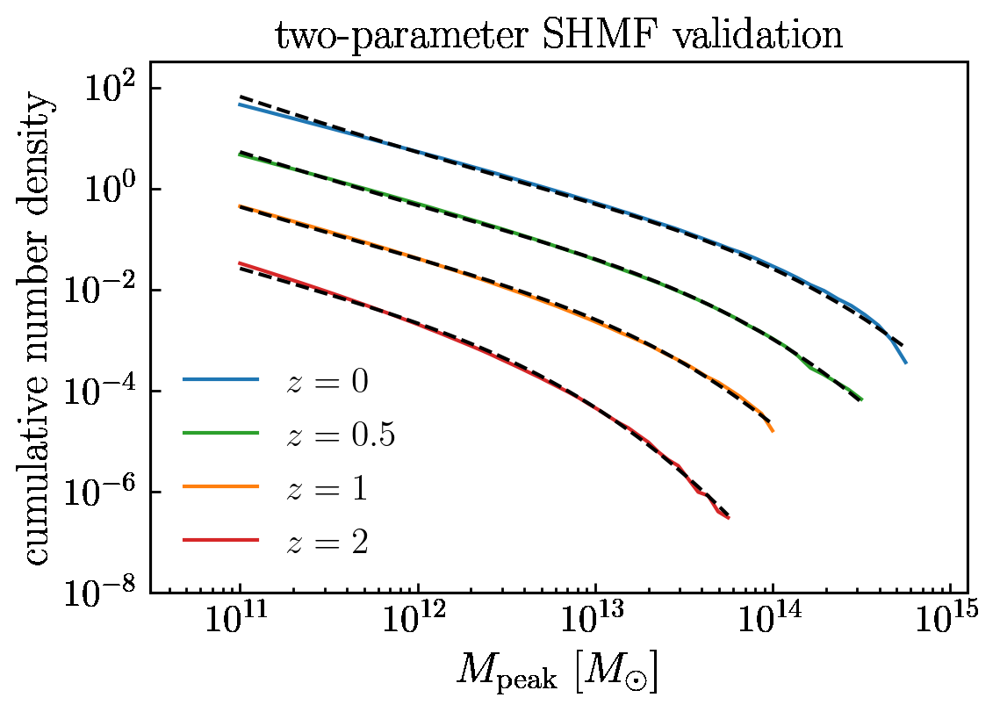

Modern scientific inquiry across fields like cosmology, astrophysics, and fluid dynamics often grapples with complex systems governed by intricate physical laws. Simulating these systems accurately requires immense computational resources, making exhaustive exploration of parameter spaces and robust statistical inference computationally prohibitive. This challenge has driven the development of advanced computational techniques, particularly emulation and inference, to accelerate scientific discovery. Emulation involves constructing fast, accurate surrogate models (emulators) that mimic the behavior of expensive simulations, while inference utilizes these emulators to efficiently constrain physical parameters, propagate uncertainties, and explore vast model spaces.

The power of emulation and inference lies in their ability to bridge the gap between theoretical models and observational data. By leveraging machine learning, statistical methods, and reduced-order modeling techniques, researchers can build computationally inexpensive surrogates that capture the essential physics of high-fidelity simulations. These surrogates enable rapid forward modeling, allowing for efficient likelihood evaluations, Bayesian inference, and sensitivity analyses. Furthermore, integrating uncertainty quantification into these frameworks is paramount, providing not just predictions but also reliable estimates of their confidence, which is crucial for making robust scientific conclusions and guiding future experiments.

My research extensively focuses on developing and applying sophisticated machine learning and statistical methodologies for emulation and inference across a range of complex scientific domains. I have pioneered the use of probabilistic neural networks and Gaussian process emulation to construct high-fidelity, reduced-order surrogates, effectively enabling the latent-space time evolution of complex fluid flows and probabilistic data recovery. This work extends to developing specific emulators for cosmological observables, including the matter power spectrum for both standard and modified gravity cosmologies, such as f(R) gravity, alongside facilitating emulator-based inference of crucial cosmological subgrid models.

A significant aspect of my contributions involves ensuring both the efficiency and reliability of these advanced AI tools. I have developed frameworks for interpretable uncertainty quantification in AI applications within High Energy Physics, ensuring that predictions are not only accurate but also accompanied by transparent measures of confidence. Additionally, I have focused on creating differentiable prediction models, exemplified by SHAMNet for large-scale structure, which allows for efficient gradient-based optimization and robust cosmological inference. These methodologies collectively accelerate the exploration of complex parameter spaces, enhance our ability to extract insights from data, and provide trustworthy predictions for fundamental scientific problems.

  

    
    
From: Emulator-Based Inference of Cosmological Subgrid Models

  

  

    
    
From: Differentiable Predictions for Large Scale Structure with SHAMNet

  

  

    
    
From: Probabilistic neural network-based reduced-order surrogate for fluid flows

  

<!-- Figure Modal -->

  &times;
  

