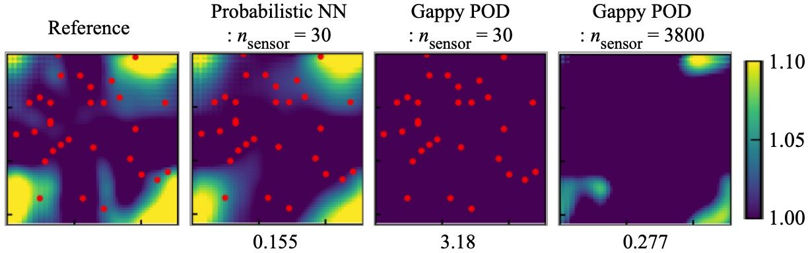
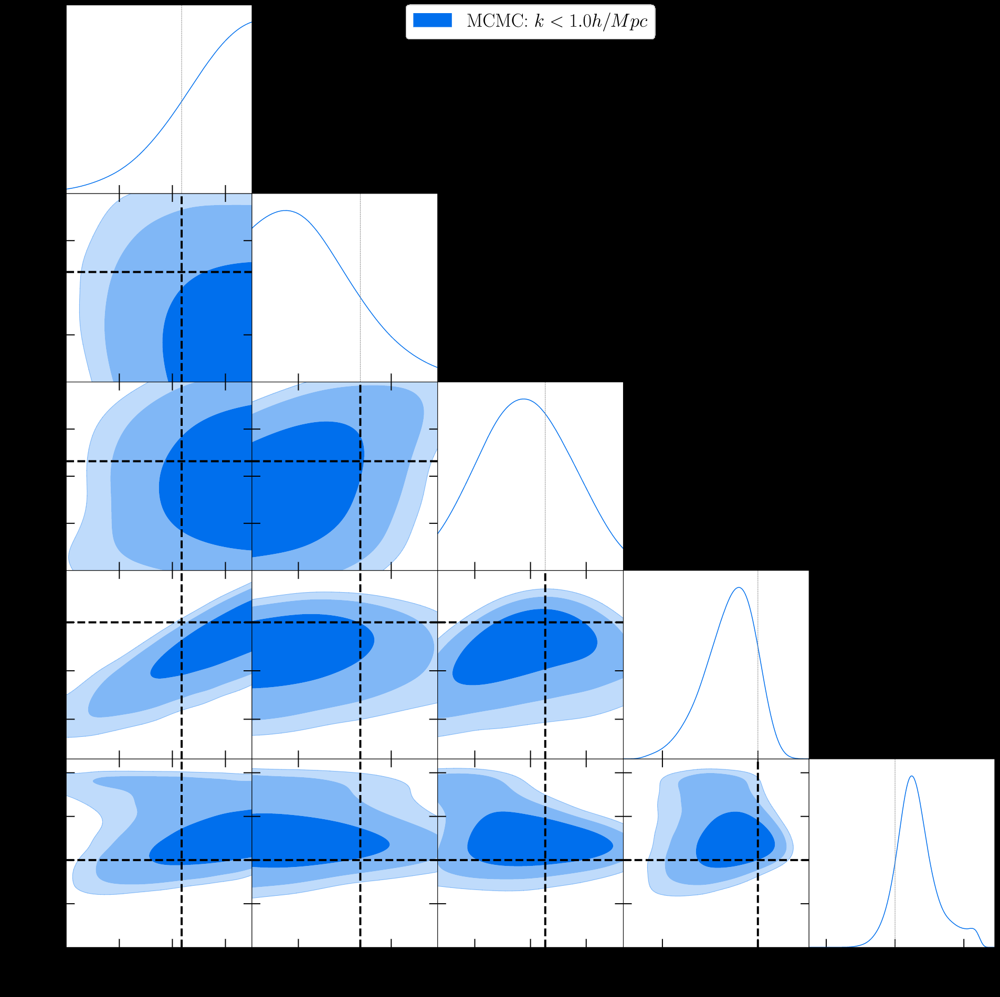

The frontier of scientific and engineering research is increasingly characterized by computationally intensive simulations, essential for understanding complex phenomena and optimizing intricate designs. However, the high computational cost associated with these high-fidelity models often hinders comprehensive parameter exploration, real-time analysis, and uncertainty quantification. This challenge has spurred significant innovation in the development of surrogate models, emulators, and reduced-order models (ROMs). These techniques are designed to approximate the behavior of complex systems with drastically reduced computational expense, thereby enabling efficient exploration of high-dimensional parameter spaces and accelerating discovery cycles across various disciplines.

A critical component of reliable scientific inquiry is the rigorous quantification of uncertainty. Beyond simply speeding up computations, it is imperative to understand the confidence associated with model predictions and the propagation of uncertainties from input data and model assumptions. Uncertainty Quantification (UQ) provides the framework for this, and its integration with modern machine learning and artificial intelligence methods is vital for developing trustworthy, interpretable predictive models. This ensures that scientific conclusions drawn from these models are robust, well-characterized, and supported by quantifiable measures of their reliability, particularly in data-rich fields like cosmology, high-energy physics, and fluid dynamics.

My research specifically focuses on developing and applying advanced probabilistic machine learning techniques to address these grand challenges in scientific computing. I have developed novel frameworks for emulation and inference, leveraging Probabilistic Neural Networks (PNNs) and Gaussian Process emulation to build highly accurate and computationally efficient surrogate models. A significant contribution involves the creation of reduced-order surrogates for complex fluid flows, where PNNs not only accelerate simulations but also inherently quantify uncertainty in their predictions. This includes exploring latent-space time evolution for non-intrusive reduced-order models, enhancing their predictive capabilities for dynamic systems.

I have applied these methodologies to critical problems across various scientific disciplines. In cosmology, my work includes emulator-based inference of cosmological subgrid models and the development of matter power spectrum emulators for modified gravity theories, enabling more efficient exploration of alternative universe models and refining our understanding of large-scale structure formation. Furthermore, I have contributed to interpretable uncertainty quantification in AI for High Energy Physics, ensuring robust and reliable scientific discovery from vast experimental datasets. My research also extends to using PNNs for fluid flow surrogate modeling and data recovery, demonstrating the robustness of these probabilistic approaches in handling sparse or incomplete data while providing essential uncertainty estimates, thereby advancing both the efficiency and trustworthiness of scientific computation.

  

    
    
From: Emulator-Based Inference of Cosmological Subgrid Models

  

  

    
    
From: Probabilistic neural network-based reduced-order surrogate for fluid flows

  

  

    
    
From: Matter Power Spectrum Emulator for f(R) Modified Gravity Cosmologies

  

<!-- Figure Modal -->

  &times;
  

